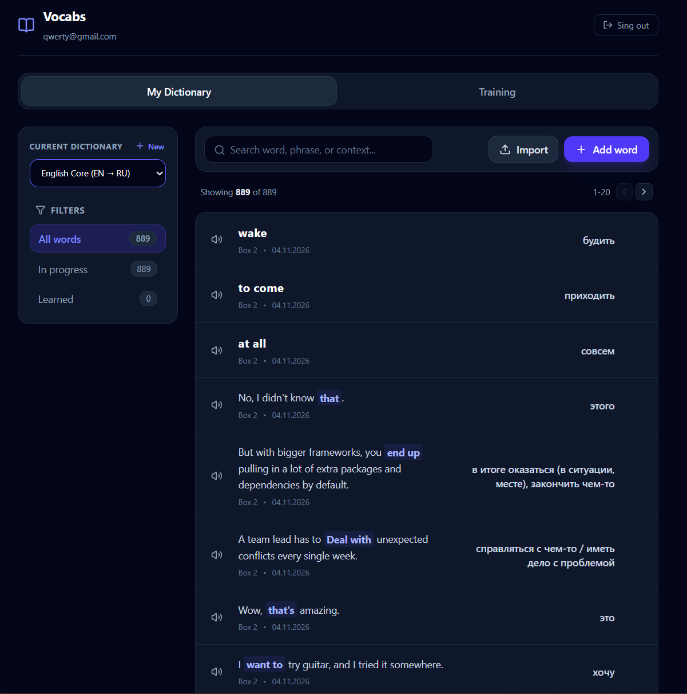
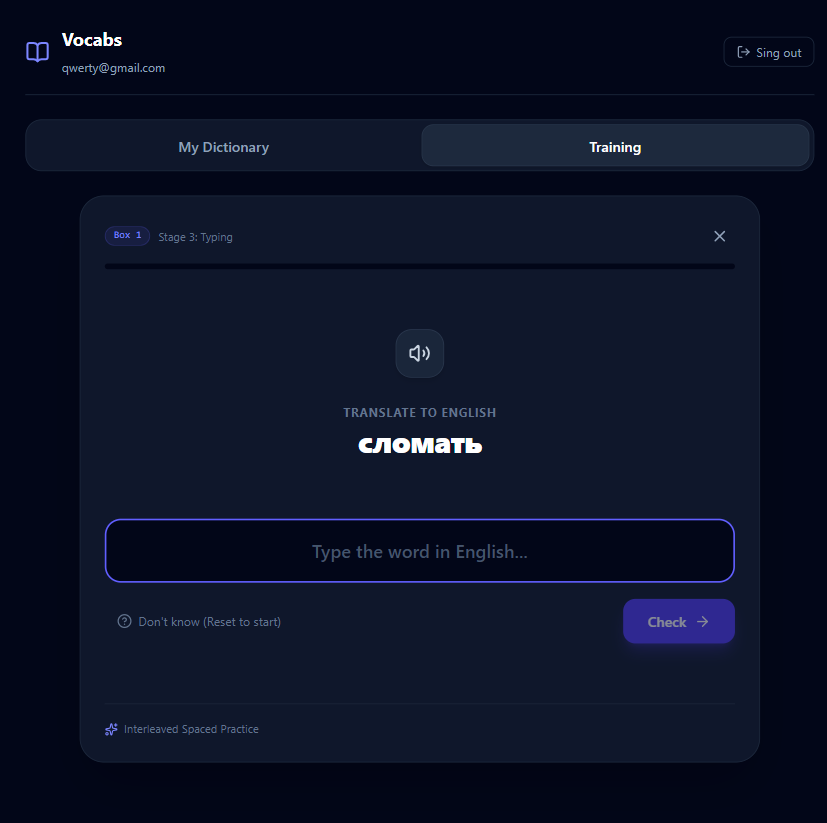
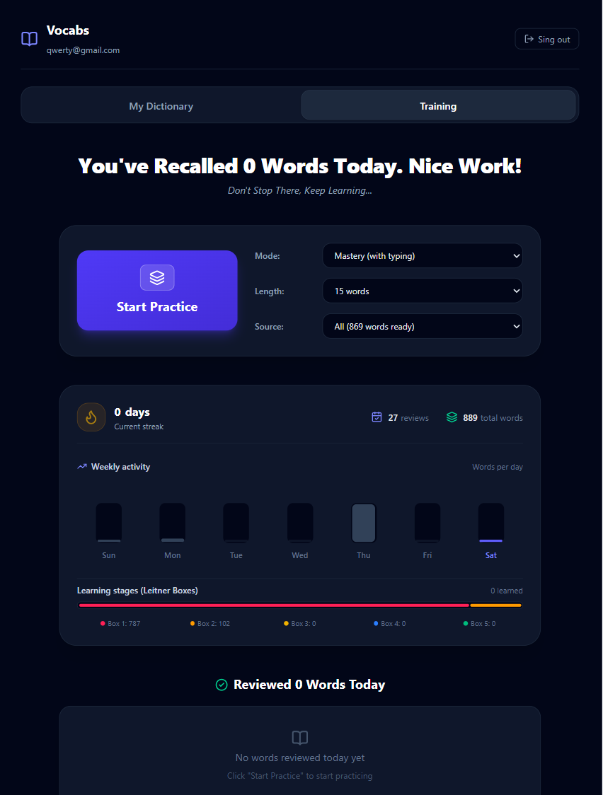
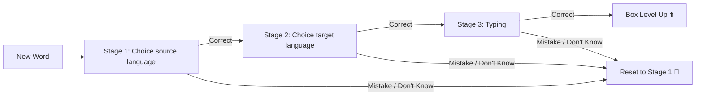

# 🧠 Vocabs — Spaced Repetition & Interleaved Flashcards

**Master new vocabulary through multi-stage interleaved practice and Leitner spaced repetition.**

  <a href="#-features">✨ <b>Features</b></a> &nbsp;│&nbsp;
  <a href="#-how-it-works">🧩 <b>How It Works</b></a> &nbsp;│&nbsp;
  <a href="#-supabase-database-setup">🗄️ <b>Database</b></a> &nbsp;│&nbsp;
  <a href="#-getting-started">🚀 <b>Getting Started</b></a> &nbsp;│&nbsp;
  <a href="#-roadmap">🗺️ <b>Roadmap</b></a>

---

> [!NOTE]
> **Vibe-Coded Project Disclaimer:** This project was built using a **vibe-coding** workflow — combining iterative AI prompting with hands-on architectural guidance. While there was definitely some good old-fashioned copy-pasting along the way, I actively kept the codebase structured, modular, and readable rather than letting it turn into spaghetti code.

## 📸 Preview

  
  
    
  

---

## ✨ Features

- **🔄 3-Stage Interleaved Sessions:** Instead of mindlessly flipping cards, words are shuffled and tested across escalating difficulty stages within a single session:
  1. **Stage 1 (`target_language → source_language`):** Recognition via multiple choice.
  2. **Stage 2 (`source_language → target_language`):** Reverse recognition via multiple choice.
  3. **Stage 3 (`Typing`):** Active recall — type the exact English word from memory (with instant progress reset if you hit _"I don't know"_).
- **📦 Leitner Box Spaced Repetition:** Cards move up boxes as you succeed and drop back when you slip, ensuring you review words right before you forget them.
- **📚 Multi-Dictionary Support:** Separate your vocabulary by topic, book, or course.
- **📥 Readlang Import & Auto-Translate:** Bulk-import your saved words directly from Readlang exports (CSV/TXT) or add single cards with built-in auto-translation and Text-to-Speech (TTS) audio.
- **📊 Habit & Progress Analytics:** Track daily streaks, weekly review volume, and word distribution (_New_, _In Progress_, _Learned_).

---

## 🧩 How It Works

## 🗄️ Supabase Database Setup

To run this app with your own backend, create a free project on [Supabase](https://supabase.com/) and run the following SQL in the SQL Editor to set up the required tables and Row Level Security (RLS):

    -- ============================================================================
    -- 1. PROFILES TABLE & AUTH TRIGGER
    -- ============================================================================
    create table if not exists public.profiles (
    id uuid references auth.users on delete cascade primary key,
    email text,
    is_pro boolean default false,
    created_at timestamp with time zone default timezone('utc'::text, now()) not null
    );

    -- Automatically create a profile row when a new user signs up
    create or replace function public.handle_new_user()
    returns trigger as $$ begin insert into public.profiles (id, email) values (new.id, new.email) on conflict (id) do nothing; return new; end; $$ language plpgsql security definer;

    drop trigger if exists on_auth_user_created on auth.users;
    create trigger on_auth_user_created
    after insert on auth.users
    for each row execute procedure public.handle_new_user();

    -- Backfill existing users (if any)
    insert into public.profiles (id, email)
    select id, email from auth.users
    on conflict (id) do nothing;

    -- ============================================================================
    -- 2. DICTIONARIES (DECKS) TABLE
    -- ============================================================================
    create table if not exists public.dictionaries (
    id uuid default gen_random_uuid() primary key,
    user_id uuid references public.profiles(id) on delete cascade not null,
    title text not null,
    source_lang text not null default 'en',
    target_lang text not null default 'ru',
    created_at timestamp with time zone default timezone('utc'::text, now()) not null
    );

    -- ============================================================================
    -- 3. CARDS (FLASHCARDS) TABLE
    -- ============================================================================
    create table if not exists public.cards (
    id uuid default gen_random_uuid() primary key,
    dictionary_id uuid references public.dictionaries(id) on delete cascade not null,
    user_id uuid references public.profiles(id) on delete cascade not null,

    -- Card content
    word text not null,
    translation text not null,
    context text,
    audio_url text,

    -- Spaced repetition & interleaved stages (Leitner Box)
    box integer default 1 not null,
    mode text not null default 'passive' check (mode in ('passive', 'active')),
    lapses integer not null default 0,
    next_review_at timestamp with time zone default timezone('utc'::text, now()) not null,
    last_reviewed_at timestamp with time zone,
    created_at timestamp with time zone default timezone('utc'::text, now()) not null
    );

    -- Index for fast review queries
    create index if not exists idx_cards_review on public.cards (dictionary_id, next_review_at);

    -- ============================================================================
    -- 4. REVIEWS LOG TABLE (Streaks & Weekly Activity Analytics)
    -- ============================================================================
    create table if not exists public.reviews (
    id bigint generated always as identity primary key,
    card_id uuid references public.cards(id) on delete cascade not null,
    user_id uuid references public.profiles(id) on delete cascade not null,
    stage smallint not null,
    correct boolean not null,
    created_at timestamp with time zone default timezone('utc'::text, now()) not null
    );

    -- ============================================================================
    -- 5. ROW LEVEL SECURITY (RLS) POLICIES
    -- ============================================================================
    alter table public.profiles enable row level security;
    alter table public.dictionaries enable row level security;
    alter table public.cards enable row level security;
    alter table public.reviews enable row level security;

    -- Profiles: users can only read their own profile
    drop policy if exists "Users can view own profile" on public.profiles;
    create policy "Users can view own profile"
    on public.profiles for select
    using (auth.uid() = id);

    -- Dictionaries: full CRUD on own dictionaries
    drop policy if exists "Users can manage own dictionaries" on public.dictionaries;
    create policy "Users can manage own dictionaries"
    on public.dictionaries for all
    using (auth.uid() = user_id);

    -- Cards: full CRUD on own cards + ensure dictionary belongs to user
    drop policy if exists "Users can manage own cards" on public.cards;
    create policy "Users can manage own cards"
    on public.cards for all
    using (auth.uid() = user_id)
    with check (
    auth.uid() = user_id
    and exists (
    select 1 from public.dictionaries d
    where d.id = dictionary_id and d.user_id = auth.uid()
    )
    );

    -- Reviews: insert and read own review history
    drop policy if exists "Users can insert their own reviews" on public.reviews;
    create policy "Users can insert their own reviews"
    on public.reviews for insert
    to authenticated
    with check (auth.uid() = user_id);

    drop policy if exists "Users can view their own reviews" on public.reviews;
    create policy "Users can view their own reviews"
    on public.reviews for select
    to authenticated
    using (auth.uid() = user_id);

## 🚀 Getting Started

### 1. Clone & Install

    git clone [https://github.com/yakuya00/vocabs.git](https://github.com/yakuya00/vocabs.git)
    cd vocabs
    npm install

### 2. Configure Environment Variables

Create a `.env` file in the root directory:

    VITE_SUPABASE_URL=[https://your-project-id.supabase.co](https://your-project-id.supabase.co)
    VITE_SUPABASE_ANON_KEY=your-anon-public-key

### 3. Run Locally

    npm run dev

## 🗺️ Roadmap

- [ ] **i18n Localization:** Full UI switcher.
- [ ] **Expanded Test Modes:** Listening comprehension, Word Scramble, Cloze (fill-in-the-blank), and Pair Matching.

## 📄 License

